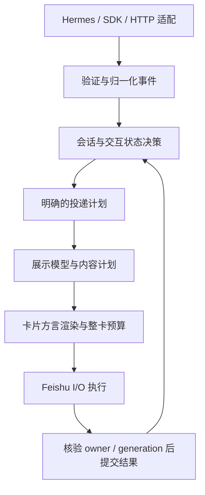

# HFC 完整重构与升级执行计划

**状态：实施中。** 日期：2026-10-13。基线：公开 v4.7.7，main/发布提交 `e03c57369503b3364313bf005d7f0e5087650557`。Bailey 已授权用五小时推进落地（北京时间 10:11–15:11）；测试与审查由独立 agent 负责，按固定提交复验。默认值、视觉方向、生产空闲与发布门槛仍按下文执行。

当前进度（2026-10-14）：候选 `48b82d9` 的 18 项云端检查通过，普通 wheel 209 项检查、125 资源来源一致。真实隔离 Hermes 安装、重复安装、doctor、恢复、重装及卸载完成，8,436 个源码文件和配置逐字恢复；这是固定 Hermes 来源的实测，不扩大到所有上游版本。Android 飞书 8.3.2 的完成/长内容卡在浅色、深色及深色放大字号下已留证；真实 `/reload-mcp` 取消与允许一次有手机截图和平台读回，仍不代表工具审批或 exactly-once 全链路。进程摘要脱敏、纯配置规则及投递错误契约已完成独立回归，累计普通 wheel（`b77599d`）931 个不同测试节点通过、127 个资源来源一致。安装来源证据与恢复事务拆分（`c889826`）已完成静态审查，946 个不同聚焦测试节点及 136 项文档检查通过，保留 1 项平台跳过和首轮 fixture 失败记录。普通 wheel（`e0081c0`）629 个不同安装态测试节点通过、131 资源来源一致；固定 Hermes 0.20 的安装、重复安装、doctor、恢复、重装、卸载链完成，8,436 个源码文件和私有配置恢复到原始内容。这些证据不替代最终云端矩阵和真实模型交互。其他运行时交互、续答导航、桌面矩阵、最终候选绑定及发行部署仍未结项；正式服务已恢复原版本与配置。

后续验收补充：`7380823` 的 active package 与 `9e84226` 相同。第五轮真实 Gateway 窗口已验证允许一次只写入一次，以及连续 clarify 的 A、[A,C]、自由文本三种原工具返回；桌面截图显示 footer 已恢复，先前额外的原生题目不再出现。Bailey 明确确认截图来自电脑端，并已在手机查看当前卡片、显示正常；手机显示按本人观察记录，不要求重复截图，也不冒称新增手机回调测试。自然超时确实返回未回答、交互卡失效且去掉按钮，但执行过程误显示绿色成功，仍须修复和针对性复核。按钮已移除，所以本轮不能声称测试过超时后的按钮点击。窗口结束后正式服务已恢复，隔离固定 Hermes 的 8,436 个源码文件与配置经官方恢复校验一致。上述限定结果不替代其余交互、配置体验、最终发布与升级门槛。

导航补充实施：第五轮已登记消息的 GET 读回含精确位置字段但缺少完整链接，不能因此把“查看续答”长期缺失当成该项完成。当前候选补充同一 IM create/reply 回执的验证位置 fallback，保留品牌、消息/聊天/话题身份、按钮预算及不查询历史的边界；GET 读回不替代原发送回执证明，真实目标点击仍须验收。

## 2026-10-14 验收范围调整

Bailey 明确由本人参与验收，不再要求 iOS 真机覆盖和五位新用户试用。
这两项从本次 V5 必交门槛中移除，不登记为已经通过；保留 Android、桌面、
真实 Gateway 流程、完整内容、交互和安装恢复等其余要求。上手路径改由 Bailey
按任务操作并核对结果，不能据此声称首次用户成功率或五人试用成绩。
下文原计划中的 iOS/五人条目保留为范围调整前记录，判断本次完成度时以上述
明确调整为准；其他未完成项不能随之省略。

本页是下一阶段的唯一执行计划入口。此前的[审查与产品建议](../reviews/2026-10-13-v5-plan.md)保留事实依据，[代码减负方案](../reviews/2026-10-13-code-surgery.md)保留具体切口；实施顺序、范围调整与完成状态统一记在本页，不维护三份进度表。

## 完成后的项目应是什么样

完整重构覆盖事件进入、状态决策、交互、显示、投递、安装恢复与开发发布这条链路。已有职责明确的小模块继续复用；历史 `legacy/` 不进入本轮。

| 目标 | 最终可观察结果 |
| --- | --- |
| 代码健壮 | 重复/乱序/晚到事件不会破坏终态；未知投递不冒充成功；旧进程或旧轮的结果不污染新状态 |
| 结构健康 | 四个大协调文件的业务职责有明确去处；核心状态/展示判断可独立测试；新模块不会反向依赖协调器 |
| 交互可信 | 点击有准确反馈，输入不被刷新清空，审批范围和历史可达，一次选择只解析一次 |
| 视觉清楚 | 状态、正文、操作、过程和统计各有合适位置；各类内容和动态过程都能通过实际客户端检查 |
| 上手容易 | 用户能选预设、看差异，并确认当前进程是否已经加载；不必靠反复改 YAML 猜结果 |
| 维护可持续 | 原因可定位、相关测试可选择、兼容分支有支持依据、临时环境不积累、路线状态跟随实际发布 |

运行协议、身份/授权、不丢内容和生产安全是硬约束。结构提取保持行为；需要修正现有行为时另列修改和验收。不得用总行数、测试数量或“发了大版本”单独证明以上目标完成。

## 已核验基线与待验证内容

以下记录启动审查时的基线；随后实施与独立验证以文末记录为准。

- 当前维护代码排除整个 `_native_hook_provenance` 后为 73 个 Python 文件、74,408 物理行；最大四个文件占 44.5%。`server._apply_event_locked_inner` 跨 1,266 行，直接访问 9 类 app 状态。行数只是耦合审查信号。
- 聚焦测试自动路由尚未覆盖 41/73 个文件；工具会拒绝未知映射，不是默默漏跑。完整 pytest CI job 在最近一次 release run 中约 22.6–32.3 分钟。
- `card-config` 已有配置来源和九状态预览，当前只证明 next-load 值。task 预设从 4.7.0 提供，原生表格从 4.7.7 提供且默认关闭。
- #374 已有报告者在 4.7.7、Hermes 0.21.7、Termux/Android、飞书个人版上的特定确认/取消通过证据；不扩大为完整手机视觉验收。#344 原场景仍未完整复现，#361 已交付观测信息而非实时日志/ETA，#392 指标需求先定义口径。
- 没有本轮新视觉截图、用户试用、运行时性能或内存基线。Python/SDK 扩大支持范围、配置已加载证明和新诊断报告都未实施。
- 本轮 check-only 确认共享 Python 3.12.13 可导入当前源码且测试依赖齐全，但固定 Hermes fixture 未配置，状态为 incomplete。共享 editable 元数据属于另一 checkout；不能把它当作发行包来源证明。

证据与可重现统计入口见[审查记录](../reviews/2026-10-13-v5-plan.md)。启动实施前重新确认 main、工作区、Hermes stable/main SHA、SDK 和测试环境；有新变更时登记差异，不覆盖已有修改。

## 架构决策

继续使用 Python、asyncio/aiohttp、PyYAML、dataclass、setuptools 和 pytest。Hermes 继续拥有执行、会话续跑与授权；HFC 负责呈现、投递和可逆安装。不引入数据库、消息队列、Web 管理后台或第二套任务引擎。

下图表示处理流程，回传结果不表示模块可以循环导入。



### 模块迁移图

以下名称是可执行的职责草案，不预建空目录。已有模块职责适配时直接复用；新模块不得成为新的万能协调器。

| 当前职责集中处 | 保留职责 | 提取/复用边界 | 禁止的依赖 |
| --- | --- | --- | --- |
| `server.py` | HTTP 接线、对象组装与受控调度 | 复用 `events/session/delivery_policy`；按需提取 `event_service`、`terminal_delivery`、`interaction_service` | 状态决策依赖 aiohttp Request、Feishu client 或反向导入 server |
| `hook_runtime.py`、`hermes_plugin_runtime.py` | 稳定 hook 入口、能力选择和启动接线 | 复用 `feishu_ws_compat/native_commands/runtime_interaction_transport`；提取事件构造、callback 适配和命令呈现 | 不同模块各建 producer/审批 resolver，或用私有循环导入维持旧全局变量 |
| `render.py`、`presentation.py` | 兼容的渲染公开入口 | `card_view`、小组件、方言输出；复用 `render_options/reading/status` | renderer 修改执行/授权状态，或访问磁盘/网络 |
| `text.py`、`native_tables.py` | 解析与已验证的结构处理 | 只读 `content_plan`，复用 `card_limits` 与既有完整内容交接 | 显示转换覆盖 canonical answer，局部预算替代整卡预算 |
| `cli.py` | 参数解析、命令分发、稳定退出码 | 先复用/扩展 `diagnostics`，再按职责分离报告、生命周期和安装命令 | 子命令反向导入 cli 私有 helpers，或把报告检查变成自动修复 |
| `maintenance_update`、`process`、`runtime_control`、`persistent_service` | 保留既有身份与事务机制 | 检查 → 有证据的计划 → 原有受保护执行 → 核验/恢复 | 把 Gateway 空闲当成所有运行进程空闲；缺证据时强停 |
| `install/patcher.py` | 唯一合法 patch 写入入口及事务编排 | 复用 descriptors、hybrid renderers、decomposed、native capability/recovery | 宽泛源码匹配、不带能力证据的版本猜测、手改已安装 Hermes |
| `config.py`、`reading.py` | 现有合并与显式值优先级 | 字段元数据及只读运行配置摘要；共用解析函数 | 第二套配置合并算法，或返回任意原始配置到群卡 |

保留 `hermes_feishu_card.cli:main`、plugin entrypoint 及已注入 hook 的公开导入路径。必要兼容委托要登记用途和清退条件；未完成调用方迁移前不删除，迁移后不长期保留两份实现。

### 内部数据契约

| 契约 | 必须表达 | 使用限制 |
| --- | --- | --- |
| Turn/route reference | profile、bot/route 归属、原 turn、generation 与必要目标引用 | 日志仅用脱敏关联信息；类型标注不能代替授权和真实性校验 |
| Normalized event | 已验证事件类型、顺序、事实来源及现有载荷 | 复用 SidecarEvent；结构提取不顺带修改外部 schema |
| State decision | 是否接受、状态变化、拒绝原因和需要的副作用 | 纯判断可离线回放；持久化/锁内提交仍由原协调边界负责 |
| Delivery plan/outcome | 稳定投递身份、冻结或明确可重算的内容、顺序/预算；delivered/not_sent/unknown | 不把它升级为新的持久化队列；结果提交前再次核验 owner/generation |
| Interaction decision | 原请求、操作者、有效期、原子 claim 与原 Hermes resolver 的结果 | 不创建第二套许可，不重放丢失响应后的审批事件 |
| Card view/content plan | 状态、正文/过程/操作的展示角色，完整内容的分段与交接 | 只读投影，不改变原答案或执行状态 |
| Config/diagnostic snapshot | 安全字段、来源、实际进程证据、时点与原因码 | 缺运行证据时标未知；报告预览后才导出，默认不上传 |

状态写入归属与第一处终态切口的详细契约见[代码减负方案](../reviews/2026-10-13-code-surgery.md)。同一 session 的条件检查、claim 与提交要保持原串行化语义；不能机械地把全部持久化移到锁外。新的 session 字段逐项选择持久化或显式排除，并验证旧 checkpoint。

## 产品升级范围

| 范围 | 本轮必须交付 | 条件与边界 |
| --- | --- | --- |
| 交互 | 明确待处理/提交/接收/失效/未知反馈；保留输入、授权范围和回看记录；诊断点击在哪层中断 | SDK、身份、resolver、回执分别验证；一次性处理规则不变 |
| 视觉 | 同内容比较两种可实现方案；统一所有关键状态的层级、字号、颜色、间距和信息密度；改善动态阅读稳定性 | 方向确认后再改外观；只用平台支持组件，不假设任意 CSS 或粘性操作栏 |
| 内容 | 原始答案与显示投影分离；统一表格/代码/长文的表示选择；结果与过程容易回看 | 目标消息确实存在才提供跳转；超限完整交接，不静默截断 |
| 配置 | 文件下次加载值与运行进程已加载值对照；预设预览和最小 YAML 差异 | 第一阶段只读/导出；写配置另按原子写、备份、作用域确认验收 |
| 诊断 | 本地脱敏报告预览/导出；来源、兼容、运行身份和投递失败分层解释 | 不自动修复、不上传配置/聊天/完整日志；不绕过 review fence |
| 上游跟进 | 更新时固定 Hermes stable/main 和 SDK；验证 native 能力、真实子进程与精确回退 | 不以版本号或说明文档替代能力证明 |
| 指标增强 | 定义阶段耗时、观测首字延迟和 #392 的 token/计时范围 | tok/s 只在同一范围有证据时显示；不足时交付“不可计算”的解释，不拼凑数值 |

不纳入：通用管理后台、永久会话档案、第二套 agent/审批/调度、旧任务自动续跑、默认实时字符估算速率、无人确认的生产自修复。它们另有边界和维护成本，不借此次重构顺带加入。

## 工作分解与依赖

T 编号是工作包，不等于恰好一个 PR。每包按独立职责拆 PR；禁止一个 PR 同时迁移状态机、改布局并升级依赖。各包状态与证据统一记在文末实施记录；单项提交不代表该工作包全部验收。

| ID | 工作包与主要文件 | 前置 | 完成条件 |
| --- | --- | --- | --- |
| T00 | 基线、契约与事件轨迹；现有 events/session/server/interaction 测试 | 无 | 冻结高风险正常/失败轨迹及原始来源；已知错误单列，不被等价性测试固化 |
| T01 | preflight 路由、受控 fixture 入口、增量静态检查、临时资源台账 | T00 的范围盘点 | 所有 active 模块有测试组或解释；未知文件拒绝；任务产物可核对与回收 |
| T02 | CLI 只读报告拆分试点；cli/diagnostics | T00 | 不变参数/退出码/关键文本契约；普通 wheel CLI 通过；新模块不反向导入 cli |
| T03 | 窄数据类型、失败阶段、诊断脱敏；events/native_hooks/diagnostics | T00 | 来源错误能区分阶段；外部错误协议保持兼容；注入失败仍 fail-closed |
| T04 | server 终态投递分离 | T00、T02、T03 的相关契约 | PATCH/重试/终局恢复与原生抑制顺序等价；旧轮不能提交新轮结果 |
| T05 | server 剩余事件决策、session/sequence/route 归属 | T04 | 协调器不再内嵌跨职责决策；状态/展示判断无需 app/网络即可测试 |
| T06 | interaction 服务与 SDK/HTTP 输入边界 | T03、T05 | 身份、claim、过期、resolver 和回执分层；一次点击只解析一次；丢响应只读确认 |
| T07 | hook/plugin 中事件、callback、命令职责分离 | T03、T06 | 公开入口和 callback 注册身份保持；每事件一个 producer；真实 PluginManager/SDK 验证 |
| T08 | 展示模型与组件提取；render/presentation/render_options | T03、T00 | 先保持原 payload 语义；纯展示可独立测试；各方言和预算保持 |
| T09 | 视觉基线与候选方案、状态信息设计 | T00 | 同内容覆盖短答/长工具/审批/长结果等关键状态，Bailey 确认方向；不拿概念稿冒充真机 |
| T10 | 卡片视觉和交互反馈升级 | T06、T08、T09 | 逐状态布局/密度/输入稳定性通过；真实点击、失败与过期有证据 |
| T11 | 完整内容计划、长结果回看；text/native_tables/card_limits | T08 | 内容无遗漏/重复；转换失败局部退回；交接未知不冒充送达；真机长内容可达 |
| T12 | 配置元数据、实际加载对照、新用户路径；config/reading/preview | T03、T08；运行摘要需现有身份契约 | 同一合并算法；作用域准确且脱敏；最小差异与预览一致；五人任务式试用 |
| T13 | 诊断报告、操作关联、指标口径 | T03、T06；加载信息复用 T12 | 可定位失败阶段、不泄露秘密；各指标数值和计时范围一致，不可靠数据省略 |
| T14 | CLI 剩余命令、维护/进程/服务检查与事务边界 | T02、T03、T05 | 检查与执行分开；多运行进程分别证明空闲；故障恢复可验证，未确认前不停止 |
| T15 | patcher 按源码家族整理、能力与恢复边界 | T03、T14 | 逐字恢复、幂等、漂移拒绝、manifest 归属与实际方法接线通过 |
| T16 | Hermes/SDK/Python/依赖支持矩阵与迁移 | T07、T14、T15 | 目标解释器普通安装与运行通过；旧环境拒绝/迁移/回退有证据；再更改声明 |
| T17 | 并发、性能、背压和资源收尾验证 | T04、T05、T10、T11、T14 | 固定基线可比较；终态/交互不被装饰性更新饿死；重复测试/异常中断无退役目录积累 |
| T18 | 清退临时委托、重复实现与已批准退役分支；同步架构/AGENTS | T05–T08、T14–T16 | 删除依据可查；支持中的路径和历史贡献保留；没有新旧双实现或循环依赖 |
| T19 | 候选全验收、文档、公开发布及生产部署 | T01 及 T10–T18 的适用范围 | 精确版本证据完整；发布与本机部署分别完成；缺口明确处理，资源回收结束 |

T09 的设计工作可在 T00 之后提前进行，不必等底层重构结束。T08 的结构提取与 T10 的外观变化分开。T13 的实时估算速率、T12 的自动写配置不属于默认必交范围；若纳入，先补准入与验收，不塞进已有 PR。

## 里程碑与建议版本安排

| 里程碑 | 工作范围 | 退出门槛 | 可交付结果 |
| --- | --- | --- | --- |
| M0 基线与设计 | T00/T01、T09；T03 契约设计 | 验证入口、可回放轨迹、资源预算和视觉方向明确 | 执行清单与可评审方案；不为计划发版 |
| M1 核心结构 | T02–T05、T08 的无外观变化部分 | 窄接口、状态/终态语义等价，普通安装与完整回归通过 | 兼容的内部改进，可按实际用户价值进入 4.x |
| M2 交互与阅读 | T06/T07/T10/T11 | 核心真实流程、外观和内容完整性通过；移动端逐项留证 | 可形成 4.8.0 兼容体验版本，旧用户默认不静默改变 |
| M3 设置与运维 | T12–T16 | 上手、排障、维护恢复与目标支持矩阵通过 | 最终升级候选，明确 V5 的迁移范围 |
| M4 收尾与发行 | T17–T19 | 非功能、清退、多端与公开包验证全部满足承诺范围 | 正式发行、准确反馈、生产更新与清理记录 |

版本号是建议占位，开始发布时核对现有 tag，避免与维护版本冲突。建议 V5 承载明确的支持范围迁移与经过验收的新用户体验；若 Python/default/schema 迁移最终没有成立依据，则保留兼容的 4.x 版本号，不制造破坏性变化。

里程碑用于汇总，不覆盖工作包依赖。M0 的视觉方向确认只阻断 T10 的外观实施；已经获准且不依赖该方向的工程工作可按依赖表继续，不能因缺一张设计稿停掉全部重构。

“完整完成”要求所有必交工作包已验收或有正式范围调整，不能因为中途发了 4.8.0 就关闭剩余计划。移动端缺设备时可以继续独立工程工作；完整跨端升级验收保留未完成，除非 Bailey 明确缩小该次发布承诺。

## 兼容、迁移与回退

| 对象 | 兼容重构阶段 | 最终升级候选 |
| --- | --- | --- |
| Python | 保持当前 >=3.9 声明与既有验证；不提前使用新 floor 语法破坏旧安装 | 建议评估 3.11–3.14；全部适用路径验证后决定下限和上限；3.15 不自动承诺 |
| Hermes/SDK | 每次按支持矩阵固定源码 SHA/能力；保留明确旧路径 | 验证实施时 latest stable/main；实际 SDK callback、插件加载和 hook 方法顺序分别证明 |
| 配置 | 原格式、global/profile/bot 优先级和显式重置不变 | 先只读差异；迁移另有备份、原子写、失败保持原状和回退说明 |
| 默认外观 | 现有 classic/focused/detailed/task 行为和显式值保留 | task 可作为新安装推荐；改变缺省值须独立确认，旧安装不静默改写 |
| 原生表格 | 继续默认关闭 | 完整多端长内容矩阵通过后再决定推荐程度；不因重构自动开启 |
| 协议/导入 | SidecarEvent、公开 CLI、plugin/hook 导入路径保留 | 必要变更单独做版本化迁移；不混在文件移动中 |
| checkpoint/manifest | 不顺带更改持久化 schema；新增临时字段显式排除 | 需要 schema 变更时验证旧读取、损坏处理、恢复与降级；禁止恢复旧授权或执行 |
| 生产进程 | 计划/测试不改变生产 | 核对 host/home/source/runtime/config；所有相关进程分别证明空闲，再按原 owner/drain 方案更新 |

当前 Python 生命周期和 Hermes 依赖声明的观察依据保存在[审查计划](../reviews/2026-10-13-v5-plan.md)。实施迁移前重新核实。旧 Python 的拒绝提示必须发生在不兼容包导入或写入安装目标之前；不能先破坏旧环境再解释不支持。

不设长期新旧双运行系统。每次结构提取用隔离测试比较纯决策；不得为对照双发消息、双调 resolver 或启动两套生产侧车。每个 PR 保持可回退，依赖升级、数据迁移与外观变化各自独立。

## 验证矩阵与执行入口

优先复用现有测试，增加测试针对行为和风险，不为“搬了一个函数”重复断言实现。下表是最小关联入口，不能代替变更影响分析或发布全量门禁。

| 范围 | 现有测试入口 | 必补或强化的组合 |
| --- | --- | --- |
| 事件/状态/终态 | `test_events.py`、`test_session.py`、`test_async_turn_ownership.py`、`test_flush.py`、integration `test_server.py`、`test_combined_stability.py` | 重复/乱序、同 key 新 generation、旧回执晚到、accepted 后终局 PATCH 全失败 |
| 交互 | `test_card_action_admission.py`、`test_runtime_interaction_transport.py`、`test_cold_start_card_callbacks.py`、integration `test_interaction_confirmation_transport.py`、`test_card_freeze.py`、`test_interaction_continuation.py` | 私聊禁群策略、错误操作者、双击、响应丢失、过期、输入保留、续答旧卡正文 |
| 显示/内容 | `test_render.py`、`test_presentation.py`、`test_task_terminal_presentation.py`、`test_text.py`、`test_native_tables.py`、`test_card_limits.py` | 结构转换不改原文、混合内容与容量、每方言、流式/静态终态一致 |
| 配置 | `test_config.py`、`test_reading_presets.py`、`test_card_preview.py`、integration `test_reading_presets_http.py` | global/profile/bot 重置、文件与运行差异、私密字段不外泄 |
| 展示恢复 | `test_session_store.py`、`test_legacy_owner_checkpoint.py`、integration `test_interaction_display_recovery.py` | 旧 schema、损坏/超限、状态待同步、不复活旧许可 |
| 安装/进程 | `test_runtime_ownership.py`、`test_runtime_control.py`、`test_process_identity.py`、`test_native_hook_capabilities.py`、`test_recovery.py`、integration `test_cli_install.py`、`test_cli_process.py` | PM 删除旧环境、身份漂移、安装中断、服务恢复失败、Gateway 空闲但 Desktop 忙 |
| 上游/平台 | integration `test_upstream_hermes_compat.py`、`test_feishu_sdk_compat.py`；现有 Docker/PowerShell CI | stable/main 精确来源、普通 wheel 真 subprocess、平台适用范围/skip 清楚 |

每个 PR：相关组/显式入口 → 集成 → diff 检查 → 记录结果。重要状态重构和发行：完整回归 + 固定上游/SDK 矩阵 + 普通 wheel。preflight 暂未覆盖的模块必须显式选组；full 缺固定 fixture 不算通过。结构迁移后确认 monkeypatch/fault injection 命中新的真实执行边界。

```bash
python tools/preflight.py --check-only
python tools/preflight.py --suite focused --module <对应组>
# 大幅运行逻辑重构/发布，先配置已验证的固定源码 fixture：
python tools/preflight.py --suite full
git diff --check
```

上游独立矩阵与源码 fixture 的处理按当前开发规则执行，不把清理掉环境变量后的普通 full 结果算成 latest stable/main 验证。

### 视觉和真实流程

固定合成内容至少覆盖短答、长文、代码、长表格、长工具、多工具、审批范围、多选/输入、失败/停止、未知/重连、独立通知及续答旧卡。先确认所有状态的信息关系，再比较同内容两种设计方向。

- 桌面：常用宽度和窄聊天区、浅/深主题、默认和放大字号，实际滚动/复制/折叠/点击。
- Android/iOS：记录具体客户端与系统版本，分别验证长标签、首屏操作发现、完整范围可达、输入与多选稳定性。API 成功、浏览器窄屏及历史单例不能替代。
- 每种已支持卡片方言先验证各自能力，再覆盖关键组合；不追求没有意义的所有配置笛卡尔积。高风险审批、终态和内容交接必须有指定客户端案例。
- 真实 Gateway/model 路径与合成 API 事件分别登记。真实 `/new`/审批测试用明确的合成、低影响任务；执行权限和数据范围遵守已授权边界。
- 没有特殊阻断时以后台 CLI/API 为主；必须操作前台的验收安排在 Bailey 方便的窗口，结束恢复主题/字号，并回收任务专用测试消息与进程。

### 非功能与代码质量

| 维度 | 基线与候选方法 | 建议门槛 |
| --- | --- | --- |
| 性能 | 固定机器、输入轨迹、外部模拟延迟，重复测解析/渲染/锁等待 p50/p95、PATCH 数和内存 | 先测基线；候选关键路径 p95 不劣化超过 10% 为初始目标，噪声及外部 API 时延单列 |
| 并发/背压 | 1/5/20 个隔离合成会话、长输出及慢下游；验证队列和终态顺序 | 队列/重试有界；终态和交互不能被中间帧淹没；不丢强制事件 |
| 资源 | 连续三轮测试、一次中断、一次失败；检查任务目录和实际 OS tmp | 已退役大目录/子进程不积累；开始时设 2 GiB 任务临时软预算，超限停止复制并解释 |
| 维护成本 | 接下来五次可比改动记录业务模块触及数、验证耗时和返工 | 新边界可独立验证；聚焦反馈先以 5 分钟为目标，完整门禁不删 |
| 静态质量 | 新提取模块逐步接入 Ruff 和 mypy；检查依赖方向 | 不新增反向依赖/循环；不全仓格式重排，不用批量 ignore 把错误藏起来 |
| 安全/隐私 | 合成秘密注入、身份错配、路径替换、symlink、错误回执和旧 token | 无秘密/原始路由泄露；变更保留 fail-open/fail-closed 各自边界 |

Ruff 的规则和范围可以显式配置，mypy 对既有代码支持逐步采用；实际工具版本在 T01 固定并验证，不修改公共 Python 环境。参考 [Ruff 配置](https://docs.astral.sh/ruff/configuration/)和 [mypy 渐进采用](https://mypy.readthedocs.io/en/stable/existing_code.html)。行数阈值只用于人工复查，验收看职责、依赖和行为，不按“减少百分之多少代码”判定。

## 发布、生产更新与回退顺序

1. 每个候选固定 commit、依赖/fixture 来源及普通 wheel 哈希，记录上述各层结果。候选使用 wheel + SHA，不把开发安装冒充公开安装。
2. 现有 release-assets resolver 只接受正式 `vMAJOR.MINOR.PATCH` annotated tag。若要公开 `rc`，先单独修改并验证 resolver、元数据、资产和安装版本契约；默认沿用候选 wheel 验收，不绕过 stable gate。
3. 更新中英文 README、配置指南、贡献记录、CHANGELOG、发行说明、wiki/AGENTS 与支持矩阵。保留已有贡献、tag、失败和重跑记录；不能把未来能力写成当前能力。
4. 取得对应范围的发布授权后，验证精确 merge/tree，完整 CI、annotated tag 和 tag gate；核对资产、checksums、公开 tag 普通安装来源。失败不移动已发布 tag。
5. 发布完成再回复相关 issue/PR，区分维护者验证与报告者场景。未复现的 #344 不因相邻功能升级被自动关闭。
6. 本机/正式环境单独核对身份和实际活跃工作；若忙，公开发行可以完成，生产升级继续标待办，不中断任务。空闲证明成立后才按受保护的维护路径更新与核验。
7. 保留旧包、必要配置/manifest 恢复证据和明确回退步骤；新 schema 如不支持降级，不允许只换旧 wheel。恢复失败立即停在已知状态，不能连续强制重装。
8. 完成后回收本任务退役环境、快照、工作树与临时进程，保留交付物和必要证据；实测记录空间变化。正式运行环境、共享依赖和用途未知文件不在清理范围。

## 进度控制、风险与交接

同一时段最多一个核心结构切口在改动；设计、只读证据整理可以独立推进，但不借此自动开子代理或多个生产实例。每批结果稳定后再进下一切口。首两处提取完成后，以真实 PR 数、回归耗时及返工估算后续容量；目前不承诺未经测量的日历工期。

| 风险 | 触发信号 | 处理 |
| --- | --- | --- |
| 移动文件但耦合未减少 | 大量传 app、反向导入协调器、万能 context 增长 | 缩小切口，明确只读数据/窄接口后再迁移 |
| 模块移动让测试虚假通过 | monkeypatch 不再命中实际 I/O | 加调用计数与故障注入证明，修正测试边界，不删除失败用例 |
| 终态/审批竞态 | 旧 generation 回写、重复 resolver、输入被 PATCH 重置 | 停止后续切口，回放定位；保留首轮失败，必要时回退当前 PR |
| 支持范围失控 | 仅凭版本放行、新分支没有 fixture | 先补能力/来源证明；未知继续按原规则拒绝或原生降级 |
| 资源反复膨胀 | 新 venv/快照数量增长、pytest 临时根没清理 | 停止新增副本，核对归属和引用后回收；不得删除活跃生产换空间 |
| 维护修复挤掉主线 | 连续小版本但计划状态不动 | 仅数据丢失/授权/无法交互等急项插队，记录被推迟 T 编号和原因 |
| 移动端或上游证据缺失 | 无设备、来源未固定、fixture 不可用 | 继续不依赖它的工作；对应 gate 保持未验证，不宣称完整完成 |

每个 T 工作包启动时追加一行记录：范围、负责执行者、基线/候选 SHA、PR、现有状态、自动化证据、平台/API/Gateway 证据、各客户端状态、回退方式、资源清理和剩余风险。维护者维护这些记录；Bailey 决定视觉方向、默认值/迁移和发行范围。其他人接手先读此页及当前 T 的证据，不重做全部历史。

### 计划当前状态

| 事项 | 状态 |
| --- | --- |
| 基线代码/发布与已有文档核对 | 已完成本轮只读核对 |
| 总体范围、架构、20 个工作包、依赖与门槛 | 本文已定义，已获实施授权 |
| 运行代码 | 多个结构与产品切口已实现，逐提交独立验证；task按B调整默认，持久化schema未迁移 |
| 新视觉方向、当前版本全移动端验收 | Bailey 最新改选 B「任务分区」；移动端真机仍待验证 |
| 完整运行回归、候选、发布与生产升级 | 冻结源码全量 5404 passed / 12 skipped，普通 wheel 与三层候选云端 CI 已通过；新解释器全量、非功能补验和客户端缺项另行登记，发布和生产升级尚未执行 |

实施完成的判定：T00–T19 的必交范围各有对应证据，所有临时双实现清退，支持/迁移承诺成立，完整内容和交互不变量通过，当前文档与公开版本一致；发行和生产部署分别结项。单个里程碑发布不等于整项重构升级完成。


### 实施记录（2026-10-13）

实现分支 `codex/refactor-upgrade-20261013`，只复用一份实现 checkout、一份独立验收 checkout 与固定 Hermes fixture。任务临时软预算 2 GiB，验证证据保留，退役大树核对后回收。

| 工作包 | 已落地切口 | 固定提交 | 验收状态 |
| --- | --- | --- | --- |
| T00/T01 | 轨迹基线、全部 active 路由、成功临时现场回收、增量 Ruff/mypy | `505f333` / `855ad27` | 18 个提取模块独立静态通过；冻结源码全量通过，任务资源收尾仍进行中 |
| T02/T03 | CLI 报告、来源探测失败阶段与受控原因 | `656b68c` / `2ad162b` | 相关回归通过；普通非 editable wheel 的外部目录、-I 与真实子进程来源验收通过 |
| T04 | 终态冻结目标与窄 I/O；retry generation 与 notice 计数修复 | `fbfa290` / `2eeaae6` | 独立终态 29 项及新增失败回归通过；首次失败保留 |
| T05 | 纯事件/route/alias；native admission 四方法 store 边界 | `db64273` / `97a857c` | route 23 项、handoff 73 项与真实 HTTP 61 项通过；完整事件协调仍有未拆部分 |
| T06 | 输入归一化、审批窗口资格；旧暂停卡重试归属修复 | `07daf38` / `4569e68` / `fbd2354` | 旧缺陷先复现 5 种失败，再 7 项修复回归通过；资格及原交互路径通过，claim/resolver 仍由 server 编排 |
| T07 | 命令卡纯构造；turn-local 排序、barrier 和有界 worker | `77174e3` / `91c7a02` | 既有 coordinator/ownership/实际 SDK 1.6.8 共 306 项通过；producer 排他归属仍在 PluginRuntime |
| T08/T09/T10 | card_view；已确认 B 方向、完成过程保留且正文去重 | `a9f4c22` / `e0d84f5` | 独立 B 36 个离线场景及去重检查通过；飞书浅色部分长结果/失败/中断像素已检查，其余外观与点击仍未验 |
| T11 | 完整来源与 native/Markdown 表示；无表格快速路径 | `56f30c2` / `f8a1ac7` | 新内容计划及相关检查通过；2121 份旧/新解析结果完全一致；新结果导航与真机长内容尚未交付 |
| T12 | 已加载默认值比较；按原合并器生成最小阅读 YAML | `89af76c` / `a67d352` | 已加载 HTTP/CLI/子进程 193 项、最小 YAML 40 项通过；五人任务式试用未完成 |
| T13 | 本地脱敏报告预览/导出；可信事件观测耗时 | `8e86b97` / `8f5920f` | 报告、时钟异常/缺失/重复、health 无额外 PATCH、checkpoint 排除均通过；tok/s 明确不可计算 |
| T14 | identity 单实现；portable 与 POSIX 文件事务各有实际 I/O 所有者 | `9351108` / `ebba839` / `5e80286` | 实际 I/O 注入 63 项通过、Windows 语义本机跳过；完整生命周期命令编排仍有后续整理空间 |
| T15/T16 | Base 三种源码契约；Hermes v0.21.7 与固定 main | `df56166` / `8d99be4` | 独立固定源码 install/repeat/doctor/restore 通过；静态通过；Python 支持声明未扩大；A/B/C 跨平台 CI 通过，D 另补 Python 3.13/3.14 完整回归，结果待定 |
| T17/T18 | 定位表格扫描热点、固定基准、兼容入口及旧别名清退 | `f8a1ac7` / `8ca1eb2` | 独立 ABBA+CPU 对比五组中位数改善、有限内存批次稳定；不外推为网络延迟/生产压测通过 |
| T19 | 冻结候选、完整回归、普通 wheel、真实 API 与资源收尾 | `8ca1eb2` 起固定代码 | 冻结源码完整 pytest 5404 passed / 12 skipped；普通 wheel、实际 PluginManager 与 5 张合成飞书 API 卡通过指定检查；尚未公开发布或修改生产 |

实现侧既有结果只记录发生过的验证，不替代 Bailey 要求的独立审查。后续发现、修复及最终验收以独立 agent 的精确提交报告为准。缺失的真机、用户试用或生产条件不会被改写为通过。

T09 方向记录：Bailey 先选 A，随后明确改选 B「任务分区」，以最新 B 为准。实现采用状态色标题、过程默认展开与完成历史可回看，保留所有显式覆盖；这不是完整真机验收。A 的旧验收不能作为 B 通过证据，独立 agent 按 B 重新复验。


本轮核心结构冻结于 2026-10-13 12:24（北京时间），其后只收独立测试、文档、已发现缺陷的修复和验证。POSIX 迁移前旧测试因访问已移除 CLI 私有名失败；迁移到真实 I/O 模块并证明故障注入触达后通过，不把无效 monkeypatch 的绿灯作为证据。

性能证据固定比较公开基线 `e03c573` 与候选 `5e80286`，同机、相同匿名 task 工作负载、交错 ABBA 进程、预热及重复采样。短答/24 工具/审批/16 会话/无表格长文的进程内 wall median 分别从 3.748/188.677/2.200/17.708/117.807 ms 变为 1.621/139.025/1.541/12.038/8.814 ms，CPU median 同向；最初受主机负载影响的尾延迟样本仍保留。该结果只说明本地状态、渲染和序列化链路，不能称为模型、Gateway、Feishu 网络或客户端提速。平台 API、真实点击、真机、五人试用和完整计划结项分别需要自己的证据。


### 独立验收检查点（2026-10-13 13:50，北京时间）

三层 Draft PR 已按职责拆分：[#394](https://github.com/baileyh8/hermes-feishu-streaming-card/pull/394) 基础设施 `96fe69d`、[#395](https://github.com/baileyh8/hermes-feishu-streaming-card/pull/395) 核心边界 `57d515c`、[#396](https://github.com/baileyh8/hermes-feishu-streaming-card/pull/396) B 阅读体验 `9812671`。三个精确候选的 tests 与 CodeQL 全部通过；测试实际 checkout 的 PR merge tree 已独立核对与 head tree 相同。旧 C Windows 首次失败也保留：长测试参数名超出 Windows 环境变量长度上限；`9812671` 只增加稳定短 ID，保留全部输入/断言，独立本机 41 项与云端 Windows 1917 passed / 2 skipped 通过。

[#397](https://github.com/baileyh8/hermes-feishu-streaming-card/pull/397) 为独立 CI 增补，`d2fda4a` 在保留 3.9–3.12 的基础上加入 Python 3.13/3.14 完整 Ubuntu 回归。118 项 CI/docs/metadata 独立检查通过，云端新解释器完整运行仍待结果。SDK 单独检查不替代完整运行证明，最低 Python 与依赖声明未改变。

本机 full 固定源码 `905b8ce`：5404 passed / 12 skipped，1269.13 秒。跳过来自 7 个历史源码样本、1 个 Windows 专项和 4 个 PowerShell 专项；固定 latest stable/main 独立矩阵另有来源与结果。普通非 editable wheel 的 118 个运行文件/资源与源文件逐字节一致；已验证外部目录、隔离导入、真实子进程、loopback 已加载配置和实际固定源码 PluginManager 加载/注册。候选元数据仍为 4.7.7，以源码与 wheel 哈希识别，不能冒充新公开版本，也不能把 PluginManager 加载扩大为 Gateway/model 任务通过。

真实飞书 API 创建 5 张合成卡，同卡运行到完成的更新通过；审批正文首尾读回，其余 schema 2.0 读取结果是兼容占位，不能据此确认正文尾部。独立客户端验收在飞书 v8.1.17 的浅色、100% 缩放下取得部分长结果、代码尾部、失败与中断正文像素。随后计算机控制返回空白截图、陈旧 AX 和 `noWindowsAvailable`；有限重试后停止。完成/审批像素、单元格尾部、滚动/复制/折叠/输入/点击、深色/放大字号、Android/iOS、真实 Gateway/model 及五人试用仍未验。未改主题与字号，无需恢复。macOS Codex Computer Use 支持后台与画中画；此次未完成原因是实际工具异常，不能归因于没有单独 PiP API。

慢下游、多会话和有界资源补验仍在进行。完整事件协调、claim/resolver、生命周期/安装剩余边界以及新结果导航仍有未交付范围。以上证据推进各工作包，不代表 T00–T19 全部结项；四个 PR 保持 Draft，未合并、发版或修改生产。


13:50 检查点之后，独立补审另推进 T14 的一个小切口：CLI 保留恢复证据的路径规划及原 legacy 分支，已验证删除时的目录句柄、全部目标先核验、按序 unlink 与 finally 关闭统一归入 `install/posix_transaction`。这是冻结候选之后的单独增补，旧 full/wheel 不自动覆盖它。`28f4aa0` 独立 CLI install/integrity/docs/metadata 351 passed / 1 Windows 专项跳过，Ruff 与 18 模块 mypy 通过；新增 8 个实际 fd、先核验后删除、平台拒绝及失败释放测试通过。新候选普通 wheel 与云端全量仍待验收。

T17 的有限慢下游/worker 轨迹保存在独立 [PR #398](https://github.com/baileyh8/hermes-feishu-streaming-card/pull/398)，源码测试提交 `562a40f`：49 项定向检查通过。三轮 1/5/20 个流式会话分别配同量交互探针，实际为 2/10/40 个总会话；终态与交互 ACK 在慢 PATCH 闸门释放前返回，最终正文隔离。实际 observer worker 的正常/503/阻塞关闭轨迹验证有界排队及释放后线程回到基线。该范围不包含生产吞吐、完整 Feishu HTTP 协议或长期驻留资源稳定性。新测试跨平台运行及进一步有限长批次采样仍待结果。


### 继续实施：交互边界（2026-10-13，北京时间）

Bailey 要求继续完成计划，前述冻结只描述当时的验收批次，后续工程继续按职责独立提交。A/B/C/E/F 精确头云端已通过；D 的现代 Python 全量通过，但 macOS 来源探测仍有一项未定位失败。G 的 Python 3.9/3.10 两项红灯来自旧 pathlib 缓存 OS 函数，导致权限故障注入未触达：`1442f0a` 补同一 accessor I/O 边界，保留拒绝和无副作用断言。本机独立 process 100 项通过；官方旧 pathlib 机制对照修前两败、修后六过，不代替原生旧解释器 CI。H 新矩阵仍待结果。

T06 继续提取 `interaction_resolver`：单次认证请求不接收 app/session，不创建第二套 claim，不重试授权；server 保留指标及锁内前后身份检查。独立真实分块 HTTP 发现旧代码会把合法 JSON 前缀提前认定为成功，原函数与提取后均复现；`ccc41f4` 在原 2 秒预算内最多读取 513 字节，等 EOF 或超限后再判断。新增 17 项、相关 123 项和 server runtime interaction 12 项独立通过，计数范围有重叠可能，不作累计覆盖声明。初次 mypy 类型收窄失败已保留，随后仅用 typing.cast 表达已验证类型，不把 bool 强转成数值。

`8be6f56` 将原请求身份保存为 repr 隐藏敏感字段的冻结快照，并提取 resolver 返回后的对象身份、token/chat 与 descriptor 校验。仍在重新取得原 session lock 后读取现有 owner，只有校验通过才执行原过期检查与状态提交；不改变 transport sequence 或将字段相等视为同一个对象。该提交的纯规则、竞态和静态验收继续由独立 agent 执行。

T05 完整事件编排、T06 其余回执与身份分层、T07/T08 剩余职责、T11 结果导航、T14/T15 生命周期及源码家族、T18 全面清退仍继续；客户端与真实用户验收单列。未合并、发布或变更生产，旧 wheel 不能覆盖此次新 resolver 运行代码。

后续 `8be6f56` 已独立通过纯规则与受控 server 竞态共 37 项、Ruff 和 19 模块 mypy；新增测试随 `9bec395` 进入实施分支。实际 claim 仍由 Hermes 原 runtime 的锁和 consumed 状态负责，侧车的快照只决定已返回结果是否仍属于原显示窗口。`be8999f` 再将辅助回执复制、脱敏、去按钮及容量检查提为不依赖 app/网络的投影；server 保留原配置/方言选择、检查点保存和投递，独立验收进行中。

第三切口 `be8999f` 独立新投影与 checkpoint/recovery/fallback 共 52 项通过；`474f95f` 增强容量故障注入后，新投影 15 项与 docs/metadata/preflight 合计 148 项通过，Ruff 与 20 模块 mypy 通过。两批有重叠，不累计为不同案例。相关普通 wheel 与最终云端全量仍需绑定新候选，不能沿用 G 的旧运行资源证明。

T05 的 `75dea4b` 将交互回复位置统一为不可变三元决策，保留 sticky IM anchor、event、session fallback 的优先级。`8df6642` 独立新增规则/实际 HTTP 与既有轨迹共 17 项通过，完整 event_rules32项通过（两批重叠）；runtime发送仍在锁外，direct发送仍在原锁内。该切口并入同一交互 Draft #402，保留各独立提交，不把它标为完整事件协调已结束。

T15 的 `5e3b9d8` 将 Gateway stale-result 完整来源契约迁入 `install/gateway_contracts`：唯一 discard guard、同块 agent_result 赋值、原 `_run_agent` 关键词与精确 pinned source tuple 一起验证。patcher 仍选择 handler、校验并移除旧 marker、生成 owned block 和写回；未改旧布局 no-op 或原拒绝错误。此提交独立审查及定向验收进行中，不能据此关闭整个 Gateway/cron 来源家族工作包。

Gateway 来源契约独立 218 项定向通过；另 143 项通过、7 项缺失 fixture 跳过，当前 latest 固定来源的实际安装/重复安装/doctor/逐字恢复与 ledger 检查通过。21 模块 mypy 与 Ruff 通过，核心 18 条 AST 判断自动对照等价（仅旧 no-op return content 规范化为纯定位器 return None）。`ec25e85` 继续把 cron 定位和共用正文/docstring helper 归到唯一所有者，保留原优先级与拒绝边界；这一后续提交单独验收，不以 Gateway 结果代签。

Cron 后续独立 387 项通过，覆盖新定位规则、完整 patcher/decomposed 及文档；最终 6137f45 的 docs/metadata/preflight133项与 Ruff/mypy22模块通过。首次 mypy 的 AST 类型收窄错误及仅 typing.cast 的修复保留；未改变匹配规则。当前完整源码家族整理仍不止这些接点，普通 wheel 与最终 CI 需覆盖 Gateway/Cron 新模块后才能进入发行判断。

T06 的 ee039e8 继续隔离前置 callback 拒绝分类、runtime/窗口双时限以及两个文本回退请求谓词。原 session 对象/id/token/chat 先于投递占位，exact int/float deadline 仍拒绝 bool 替代值；过期 mutation、profile 检查和 HTTP 优先级保持原位。716276e 的独立测试覆盖 31 个新规则与既有实际 HTTP，共77项通过，Ruff/mypy22模块通过；已与普通mode lookup短路和dict subclass差异对照。新普通包与最终CI仍需绑定该运行版本，真实点击尚未验。

T05 的 `ec3d557` 提取交互容量预检，保留 copy/new → apply → render 的顺序；配置读取、锁、指标与实际状态提交仍在 server。独立验收正在补齐拒绝后不注册会话、不修改原 owner/sequence、重复事件不渲染与副本隔离的证据，当前不计作已验收。

后续证据更新：H `adb3486` 与 I `6de9843` 的云端 tests/CodeQL 已全部通过，原生 Python 3.9/3.10 各为 H 5416 passed / 35 skipped、I 5473 passed / 35 skipped。L `472c2fc` 普通 wheel 的 122 个资源与源码、实际安装一致，SHA256 为 `4d4013523f443931a2c1a6bf4978ee5e14d6ca52a86b69eedcb741abfd451a95`；外部 `-I` 验证规则/server20项与真实HTTP5项。沿用 K 的 synthetic fixture CLI 验证仅限未变资源；完整 fixed Hermes checkout 因缺少可验证 runtime Python 未通过真实安装，未绕过门禁。客户端验收仍未完成。

T05 交互预检的独立验收已完成：22 项定向测试（15 个新增规则、7 个 HTTP）及 docs/metadata102项通过，针对性 Ruff/mypy 和三种新进程导入顺序通过。首次失败来自测试误用 deepcopy 对象等值，修正为完整存储内容对比后通过，产品代码未为此变更；真实 Python3.9运行、普通包及客户端尚未覆盖此切口。Draft #405 保留该范围。

T14 的 `904d314` 将维护排空健康校验和连续心跳证明迁入 `maintenance_evidence`。轮询、deadline、lease、锁和实际停服保留原编排；聚合 owner 数据仍归 `runtime_ownership`。本次保留原字段校验、30秒新鲜度、同owner递增和无效/忙碌重置语义。独立 operations/ownership/docs/preflight524项及追加route32项通过（有重叠，不累计），Ruff/mypy23模块通过；真实supervisor→wait→run_job命令harness证明忙碌、过期/不完整observer和Gateway冲突均不执行mutation。Draft #406；普通包和full CI另验，未实现多Gateway协同维护，也未改生产。

T05 的 `da3d18b` 把同一阶段的 owner 刷新规则迁入 `owner_display_policy`：pending/paused 普通更新冻结输入，独立回执避免覆盖前一卡，同消息保留 callback/text 方言。采用两阶段判断以保留 failed 回执先 render、之后惰性查询 mode 的顺序；没有把不同阶段的 continuation 创建、重渲染、native ledger 事务合成提前计算的计划。独立 93 个不同运行场景均有通过证据（首轮90过、3项新测试设置错误，修正后仅重跑受影响5项），Ruff/mypy24、docs102和路由4项通过；完整 T05 尚未结项。

T05/T18 的 `da89d6d` 移除 lifecycle 四处对 server 的反向导入，使用借用实时 registry 的 `CleanupState`；server 保留 AppKey 适配，清理所有者保留原身份栅栏、顺序、指标和有界历史。同时删除五个无仓库内消费者的私有导入别名，保留实现及已声明兼容入口。本批独立组合回归2263 passed / 1 skipped，Ruff/mypy25通过；纯规则、真实HTTP、cleanup/flush及命令入口覆盖均留证。普通包与full CI另验；recovery/integrity 的共享 I/O 和后续完整职责包仍未关闭。

T11 的 `63bcc49` 实现首个完整可选续答导航：IM成功回执中的message_app_link通过品牌/目标/定位校验后随投递结果传递，新owner确认后旧schema2卡追加“查看续答”。无有效链接或预算不足时保留原文字/正文，不新增请求、配置或授权。未从position猜测链接，独立240项相关场景、docs/preflight135项及Ruff/mypy26模块通过；首审发现client.base_url属性错误，4a41907改用client.config.base_url，原2项产品失败与修复后通过分开留证。普通包与真实客户端点击仍待验；历史五卡API读回不代签本功能。

恢复I/O的bd0c659统一物理操作，0693e81单独修复清理首错跳过其他fd释放；独立三入口先红3项、修后3项通过，364项原Recovery/Integrity/实际CLI回归与40项新增故障测试通过（含重叠，另有Windows专项1跳过），25模块质量检查通过。af97c97固定完整回归运行中。导航与I/O测试路由合并时仅合并JSON中的两组新增路由，后续验证保留install diagnostics与navigation client/interaction/appearance。

2026-10-14 上游兼容更新：固定 Hermes v0.22.0 `e06df9c2eae6901f4c88f464e0ae6e753c0428b8` 与当日 main `0e427d788d253630d38a3a51cd76849e73cd6925`，两组定向源码共 10 项独立检查通过。覆盖能力探测、源码安装/重复/诊断/恢复及 Base 生成方法的实际执行；SDK/runtime 安装检查由原 source-only 测试隔离，不是这两个版本的真实 Gateway 安装或客户端证明。CI 固定提交随此更新，完整云端结果另记。
